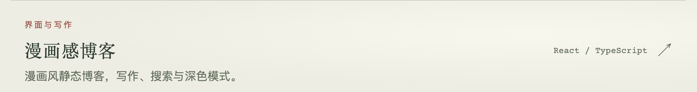
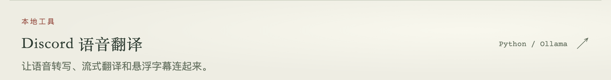
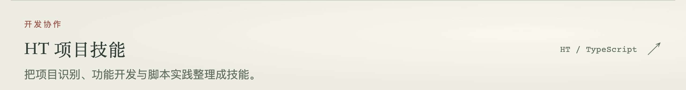

<a href="https://mingyuejiu.cn" title="访问明月几时有的个人小站">
  <picture>
    <source media="(max-width: 600px)" srcset="assets/ink-cover-mobile.png" />
    
  </picture>
</a>

  <a href="https://mingyuejiu.cn">个人小站</a>
  &nbsp; · &nbsp;
  <a href="https://mingyuejiu.cn/blog">技术笔记</a>
  &nbsp; · &nbsp;
  <a href="https://github.com/mingyue329?tab=repositories">全部仓库</a>

 

<a href="https://github.com/mingyue329/manga-blog" title="查看 manga-blog 仓库">
  <picture>
    <source media="(max-width: 600px)" srcset="assets/manga-blog-mobile.png" />
    
  </picture>
</a>

<a href="https://github.com/mingyue329/discord-translate" title="查看 discord-translate 仓库">
  <picture>
    <source media="(max-width: 600px)" srcset="assets/discord-translate-mobile.png" />
    
  </picture>
</a>

<a href="https://github.com/mingyue329/ht-project-skill" title="查看 ht-project-skill 仓库">
  <picture>
    <source media="(max-width: 600px)" srcset="assets/ht-project-skill-mobile.png" />
    
  </picture>
</a>

<!-- 题图复用 mingyuejiu-site 的山月入墨画面与字体风格，桌面和移动端分别排版。 -->
