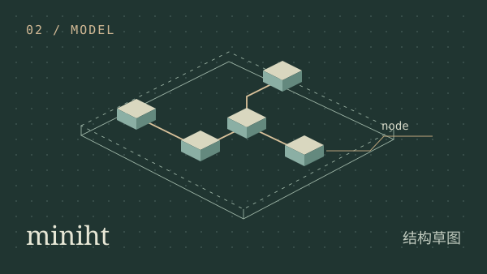

# miniht · 开发中的二维编辑器

工作里写了快三年 HT.js，我最想拆开看的是一件小事：在属性面板里改一个值，画布上的节点怎么知道自己该重画？

我从 TypeScript 的 `DataModel` 开始写。节点、连线、属性变化先在数据层里说清楚，再接 Konva 的二维画布。眼下想跑通的顺序是选中节点、改属性、保存，再打开同一张图。共用这套模型的 3D 视图留到后面。

上图是设计草图。项目还在开发中，源码暂存于私有仓库。

[回到个人志](../README.md)
